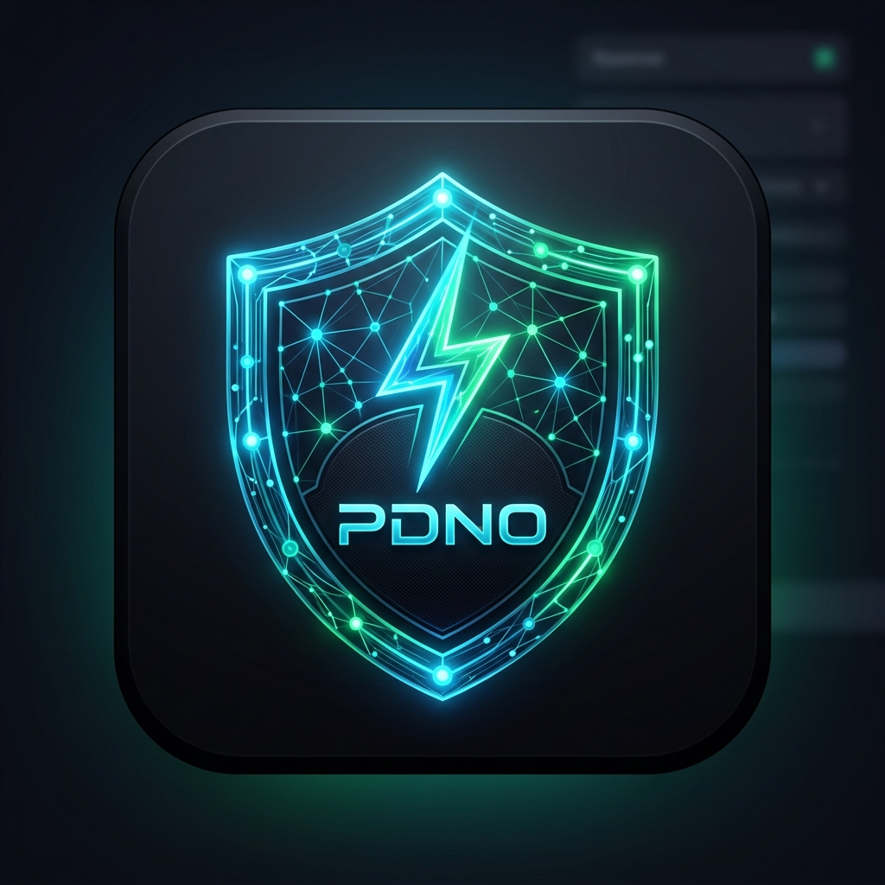

<div align="center">
  
  <h1>PDNO — PC DNS Network Optimizer</h1>
  <p><strong>Universal Standalone Anycast DNS Benchmark &amp; Network Optimizer for PC, PlayStation, Xbox &amp; Linux</strong></p>

  <p>
    
    
    
    
    
    
  </p>
</div>

---

## Overview

**PDNO** (PC DNS Network Optimizer) benchmarks all **26 Anycast / DoH resolvers** from [dnsspeedtest.online](https://dnsspeedtest.online), measures live round-trip latency, packet jitter, and query response times from your physical network connection, and provides optimal static DNS to achieve **sub-20ms gaming latency with 0 jitter** across **Windows, Linux, PlayStation 5/4, and Xbox Series X|S / One**.

---

## Universal Multi-Platform Support

PDNO dynamically adapts to whichever system and devices you use:
- **🪟 Windows 10 & 11**: Full standalone desktop GUI (`PDNO.exe`). Dynamic hardware adapter detection (Realtek 2.5GbE, Intel Wi-Fi 6E, Killer, Marvell, USB Docks), 1-click static DNS locking, and hardware power-throttle removal (`Green Ethernet`, `Energy Efficient Ethernet`).
- **🐧 Linux (CLI)**: Native standalone ELF binary (`PDNO-linux-x64`) for Ubuntu, Debian, Fedora, Arch, and SteamOS with `systemd-resolved` integration.
- **🎮 PlayStation 5 & PlayStation 4**: Dedicated in-app interactive console guide with 1-click clipboard copy of measured lowest-ping static DNS.
- **🟩 Xbox Series X|S & Xbox One**: Step-by-step low-latency DNS setup to eliminate matchmaking lobby ping spikes and NAT delays.
- **🌐 Home Routers**: Router WAN/DHCP setup instructions so every PC, console, and mobile device on your home network inherits the lowest latency Anycast routing simultaneously.

---

## 🎮 PlayStation & Xbox Console Setup

Because gaming consoles operate on closed firmware, PDNO benchmarks your local ISP connection directly from your home network and gives you the exact sub-20ms static IPs to enter into your console:

### 1. PlayStation 5 & PlayStation 4
1. From the home screen, navigate to **Settings** (gear icon) > **Network**.
2. Go to **Settings** > **Set Up Internet Connection**.
3. Highlight your connected Wi-Fi or LAN Cable network, press the **Options button** (three lines on controller) > **Advanced Settings**.
4. Select **DNS Settings** and switch from `Automatic` to `Manual`.
5. Enter the Primary and Secondary DNS IPs determined by PDNO:
   - **Primary DNS**: e.g. `1.1.1.1` (or EU sovereign `86.54.11.100` / Quad9 `9.9.9.9`)
   - **Secondary DNS**: e.g. `1.0.0.1` (or `149.112.112.112`)
6. Leave MTU on Automatic, save, and run **Test Internet Connection** to confirm lower latency.

### 2. Xbox Series X|S & Xbox One
1. Press the **Xbox button** on your controller to open the guide.
2. Select **Profile & system** > **Settings** > **General** > **Network settings**.
3. Select **Advanced settings** > **DNS settings** > **Manual**.
4. Enter the **Primary IPv4 DNS** (e.g. `1.1.1.1`) and press Enter.
5. Enter the **Secondary IPv4 DNS** (e.g. `1.0.0.1`) and press Enter.
6. Press **B** to save and run **Test multiplayer connection** to confirm zero packet loss.

### 3. Home Router (All Consoles at Once)
Set the primary and secondary DNS on your router gateway (`http://192.168.1.1` or `192.168.0.1` under WAN/Internet or DHCP Server). All connected PS5, PS4, Xbox, Nintendo Switch, and PC systems will automatically route through the optimized Anycast network without needing per-device configuration.

---

## Consumer-Friendly Downloads & Installation

### 🪟 Windows 10 & 11 (GUI Application)

#### 🚀 Option A: 1-Click Consumer Installer (Recommended)
- **Installer**: `PDNO-Setup.exe`
- **Zero build or SDK required**: Download and double-click `PDNO-Setup.exe` to install.
- Adds Start Menu shortcut, Desktop icon, and full Windows uninstaller support.
- Automatically launches upon install.

#### ⚡ Option B: Standalone Portable (Zero Install)
- **Executable**: `PDNO.exe` (or launch via `run.bat`)
- 100% self-contained single-file portable binary. No installation or .NET runtime needed. Just double-click to run anywhere.

### 🐧 Linux (CLI Executable)
- **File**: `PDNO-linux-x64`
- Single-file ELF binary for Linux terminals.
- Usage:
  ```bash
  chmod +x PDNO-linux-x64
  ./PDNO-linux-x64             # Benchmark all 26 servers
  ./PDNO-linux-x64 --eu        # EU NIS2/GDPR cybersecurity mode
  ./PDNO-linux-x64 --console   # Display PlayStation & Xbox setup guide
  ./PDNO-linux-x64 --apply     # Apply winning static DNS to active interface
  ```

---

## 26 Supported Global DNS Resolvers

Cloudflare, Google Public, Quad9, Control D, AdGuard, DNS.SB, CleanBrowsing, NextDNS, DNS4EU, OpenBLD, Canadian Shield, Digitale Gesellschaft, DNS for Family, Restena, IIJ, LibreDNS, Switch, Applied Privacy, UncensoredDNS, RethinkDNS, FlashStart, Comcast Xfinity, AliDNS, DNSPod, 360 Secure, OpenDNS.

---

## 🛡️ Security Hardening & Strict Anti-Privilege Escalation

PDNO incorporates multi-layered defense-in-depth protections to ensure untrusted code or scripts cannot compromise the application, execute unauthorized commands, or escalate privileges:

1. **Strict Anti-Privilege Escalation (CWE-250, CWE-269)**:
   - **`asInvoker` Application Manifest**: Explicitly enforced in `app.manifest` (`<requestedExecutionLevel level="asInvoker" uiAccess="false" />`). The application runs strictly with the caller's standard user token and Windows will never allow it to request or obtain elevated permissions at runtime.
   - **Zero Elevation Hooks (`RunAs` Strictly Prohibited)**: All internal system operations run with `UseShellExecute = false`, `CreateNoWindow = true`, and empty `Verb`, strictly bypassing UAC elevation hooks and prompt injection.
   - **Runtime Assertion Policy**: `SecurityShieldService.AssertNoPrivilegeEscalation` programmatic validation rejects any process creation containing elevation verbs, `UseShellExecute = true`, or non-System32 working directories.
   - **Installer Least Privilege**: The Inno Setup installer (`installer.iss`) enforces `PrivilegesRequired=lowest` and `PrivilegesRequiredOverridesAllowed=` (no overrides allowed), preventing installer privilege escalation and installing cleanly to `%LocalAppData%\Programs\PDNO`.
2. **Script Shield & Directory Audit**:
   - On startup, `SecurityShieldService` audits the execution directory for suspicious or unauthorized scripts (`.vbs`, `.js`, `.hta`, `.scr`, untrusted `.ps1` / `.bat`).
   - If rogue files are detected, execution is isolated and the application automatically halts (`Shutdown(1)`).
3. **DLL & Binary Planting Defenses (CWE-426)**:
   - Uses Windows Kernel `SetDllDirectory("")` and `SetDefaultDllDirectories` to permanently strip the Current Working Directory and untrusted locations from the DLL search order.
4. **Command Injection Prevention (CWE-78)**:
   - All network operations invoke system-pinned binaries (`%SystemRoot%\System32\netsh.exe` and `ipconfig.exe`).
   - Process execution forces `WorkingDirectory = System32` so local files are never resolved by relative paths.
   - Script commands are strictly validated against an internal allowlist and encoded in Base64 (`-EncodedCommand`) to eliminate quoting breakout.
5. **Batch & Shell Isolation (`run.bat`)**:
   - `run.bat` enforces isolated system PATH (`%SystemRoot%\System32`), verifies binary authenticity, and pre-checks for unauthorized script payloads.
6. **Delivery Formats**:
   - **1-Click Consumer Setup**: `PDNO-Setup.exe` (silent, user-level, zero UAC prompt).
   - **Standalone Portable Binary**: `PDNO.exe` (run directly without installation).

---
## License

MIT License &middot; Free & Open Source &middot; Zero Telemetry

